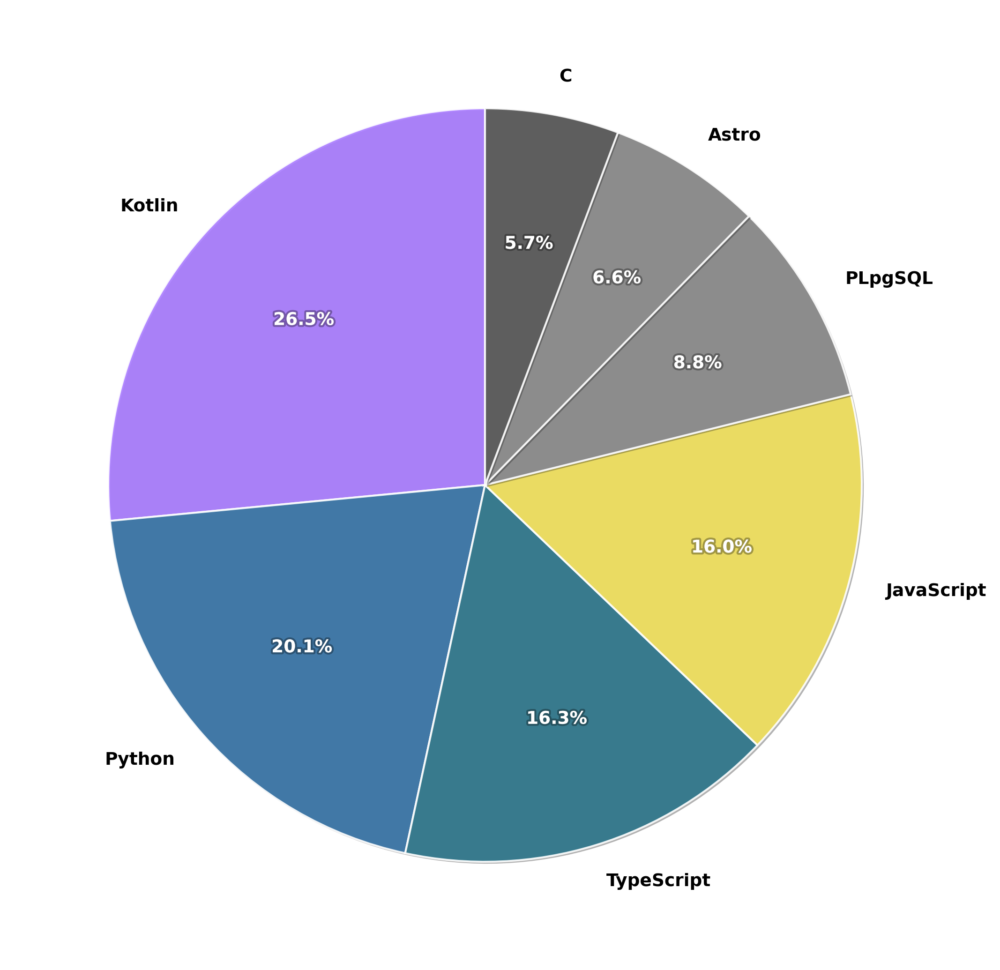

# Hi, I'm Jasmine 👋

🙋‍♀️ Computer Science graduate from Monash University (Algorithms and Software)

📍Melbourne, Australia

I mainly build web and mobile apps, mostly with TypeScript/JavaScript, Kotlin and Postgres. Currently looking for entry-level software developer roles in Melbourne.

- LinkedIn: [jasmine-irawan](https://www.linkedin.com/in/jasmine-irawan)
- Portfolio website: [jasmineirawan.dev](https://jasmineirawan.dev)

## Projects

**[Mogo](https://github.com/jasminepi5/mogo)**: Android rideshare app built as my Monash capstone (FIT3161/3162, HD). Kotlin, MVVM, Supabase and the Google Maps SDK. I mainly worked on backend and testing.

**Patroli**: QR checkpoint patrol logging system for security guards in Indonesia. A lightweight web app so it runs on older phones, with Supabase as the backend and a supervisor dashboard. *(Client project)*

## Tech Stack

### I mainly work with

<!-- Languages -->

<!-- Miscellaneous tools -->

<!-- Code editors & IDEs -->

### I'm currently learning

### Coursework exposure only (so far)

<!-- Languages -->

<!-- Code editors / IDE -->

<!-- Frameworks / libraries, misc. tools -->

<!-- ## GitHub stats -->

<!-- Generated by .github/workflows/stats.yml; filename is <type>_by_<repos|bytes|weighted>.png -->

<!-- 

  

 -->
